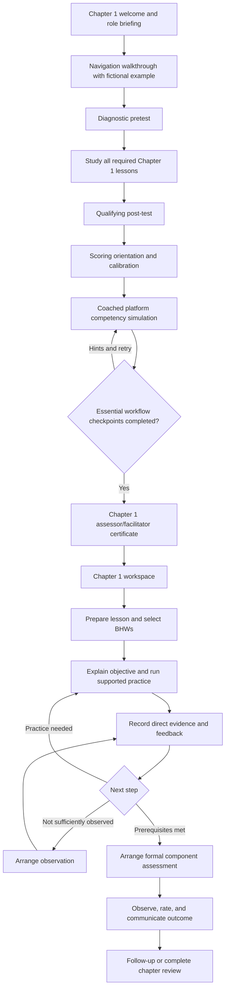
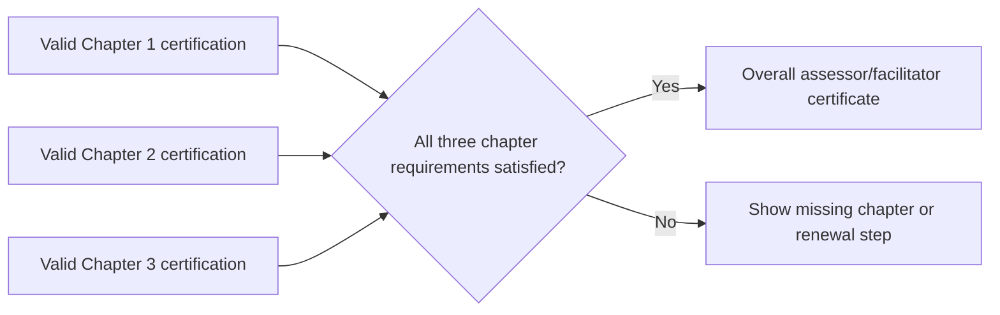

# Chapter 1 assessor/facilitator flow: incremental implementation plan

Planning baseline: 10 October 2026, repository commit `a1a54d75`.
Status: implementation plan; no application, curriculum, database, or publication changes made by this document.
Executor: Sol, one bounded increment at a time. Increment IDs below are new `C1AF` work, not renumbered historical AF-01–AF-05 work.

## Implementation ledger — 11 October 2026

| Increment | Local status | Reviewable result |
| --- | --- | --- |
| C1AF-01 | Contract complete; dependent policy approvals remain explicit | [State/permission contract](chapter-1-assessor-flow-contract.md), decisions D01–D16, review gates R01–R07 and worked cases X01–X20. |
| C1AF-02 | Read-only audit and draft crosswalk complete | [Mapping audit](chapter-1-assessor-mapping-audit.md), [42-lesson proposals](chapter-1-assessor-map-proposals.json), [reproducible source snapshot](chapter-1-assessor-audit.json) and local audit CLI. No live mapping approval. |
| C1AF-03 | Draft implementation complete locally; semantic activation remains gated | [Catalog, criterion registry and pure state contracts](chapter-1-assessor-state-contracts.md). All draft criteria remain unreviewed and grant no authority. |
| C1AF-03b | Implemented locally; release verification remains incomplete | Default-off controls, explicit cohort policy and persisted cutover. PGlite checks and final native PostgreSQL replay pass (72 migrations, ten scenarios). Full local Supabase replay remains required before merge. |
| C1AF-04 | Items 1–4 implemented locally; release checks remain | [Opening briefing handoff](chapter-1-assessor-briefing-handoff.md): bilingual objectives, preparation sequence, fictional tour and explicit versioned personal acknowledgement. Final browser save/resume and full local Supabase verification remain; not deployed. |
| C1AF-05 | Implemented locally; full application E2E remains | [Preparation checklist handoff](chapter-1-assessor-preparation-handoff.md): seven preparation steps, one recommendation, 42-lesson inventory, subchapter groups and saved bookmarks. Existing qualifications remain distinct from revised certification. |
| Remaining increments | Not started | Follow the dependencies and release boundaries below, including mandatory 03b controls and the guided simulation before new-rule award issuance. |

These are local deliverables, not merged or deployed releases. Local application code includes default-off rollout controls and a briefing with explicit personal acknowledgement and a read-only preparation checklist. BHW lesson content, reviewed curriculum pins, pilot database records and publication are unchanged. Verification results and the next bounded tasks are recorded in the linked handoffs. Complete each increment's separate review/PR before treating it as shipped.

## 1. Outcome and scope

An assessor/facilitator can understand their responsibilities before studying, become certified for a chapter, prepare and facilitate its lessons, record useful practice evidence, formally assess a BHW, and manage follow-up without reconciling conflicting instructions or guessing the next action.

The user has established two levels of assessor/facilitator certification:

1. A separate certificate for each of Chapters 1, 2, and 3.
2. An overall certificate covering all three chapters.

Deliver the revised working experience for Chapter 1 first. Build shared certification contracts for all three chapters now. Chapter 2 already has candidate-learning/exam/orientation implementation; preserve it. Chapter 3 certification must remain visibly unavailable until its actual requirements, assessment material, and release are ready. Never infer readiness from the existence of Chapter 3 learner content.

This plan changes workflow, guidance, evidence handling, and certification. It does not authorize a wholesale rewrite of the 42 BHW lessons, new clinical teaching, media regeneration, or automatic republication. Opening-briefing copy and workflow examples are new interface guidance. Necessary rubric conflicts are resolved explicitly and versioned in isolated increments before affected assessment actions go live.

## 2. Working decisions and policy boundaries

These are the proposed implementation defaults. They make the plan executable; they do not claim that unresolved rubric or assessment policy has already been approved.

| Topic | Working decision |
| --- | --- |
| Role | Keep the existing `assessor` account type. Show separate preparation, facilitation, and formal-assessment modes within it. |
| Chapter certificate | One combined **Assessor/Facilitator — Chapter N** award, with traceable preparation and scoring evidence. |
| Chapter authority | A valid Chapter 1 certification authorizes official Chapter 1 facilitation and assessment within the person's catchment, subject to account status and assignment. It does not require overall certification first. |
| Before certification | Permit personal study, guide review, private planning, and fictional practice. Do not create official BHW observations, record delivery, or decide assessments in the new flow before chapter authorization. Supervised candidate delivery is outside this initial plan. |
| Overall award | Issue when valid certifications for all three distinct chapters satisfy the same versioned program award rule. No additional capstone or exam is introduced by default. |
| Order of chapters | Do not add a mandatory 1→2→3 sequence. Honor only prerequisites explicitly contained in approved chapter requirements. |
| Existing preparation | Preserve diagnostic pretest, full required chapter study, 80% qualifying post-test, and scoring orientation. Chapter 1 currently has six orientation lessons and eight cases with a 7/8 plus safety rule; preserve as the baseline pending existing review, not a newly approved standard. |
| Practical assessment of candidates | Retain the exemption from assessment by another assessor. Add a versioned, coached **Practice facilitation and assessment** simulation after scoring orientation and before new chapter certification. Require successful completion of essential workflow checkpoints under the new award rule, with hints and unlimited retries; introduce no additional percentage score or high-stakes exam. |
| Same facilitator and assessor | Permit the same certified person to facilitate and assess a BHW for the initial pilot; clearly identify the purpose of each attempt. Independent assignment can be supported without making a second assessor mandatory. |
| Formal assessment unit | Use a subchapter component with explicitly mapped required criteria. A lesson practice attempt can support preparation but does not automatically satisfy an entire component. No separate per-lesson certificates. |
| BHW readiness | Check that component's approved learning prerequisites. Do not impose the assessor's 80% exam requirement on BHWs or invent mandatory subchapter quizzes. |
| Final BHW decision | Require all approved component criteria and chapter prerequisites; do not average away missing evidence. The exact sufficiency and reassessment rules are signed off with the assessment contract. |
| Certificate meaning | An award within the BHW Reference Manual program. Do not label it TESDA NC II certification, professional licensure, or statutory accreditation. |
| Availability | Unpublished or unapproved requirements remain unavailable. An unavailable Chapter 3 does not shrink the overall award denominator from three to two. |

The following need a concrete decision in C1AF-01 before dependent write paths are enabled: the combined award's issuer/title; component criteria and evidence sufficiency; resolution of lesson-versus-subchapter rubric conflicts; current orientation threshold/case review; simulation checkpoint acceptance and treatment of historical qualifications; program version equivalence and renewal. Sol may build navigation, fixtures, and additive structures while these are pending. Sol must not invent a clinical standard or silently resolve contradictory rating anchors to unblock a release.

## 3. Target journeys

The assessor always sees their current mode and one recommended next action. The BHW sees the learning objective, whether the activity is practice or assessment, arrangements when applicable, and released feedback with the next step. Private assessor notes and answer keys remain private.

## 4. Repository baseline and reuse

| Existing foundation | Reuse and required change |
| --- | --- |
| `content/assessor/bhw-reference-manual.v1.json` | Keep authored requirements and source pinning; add reviewed versions rather than rewriting hashes to pass checks. |
| `src/lib/assessor/{curriculum,learning,readiness}.ts` | Reuse study requirements and pure readiness contracts; distinguish candidate state, evidence state, certification validity, and actor authority. |
| `src/app/training/[programId]/assessor/[chapterKey]/[[...path]]/page.tsx` | Preserve personal progress, resume and exam routes; add briefing, grouped progress and clear mode navigation. |
| `src/components/elearning/assessor-{exam,orientation,qualification-card}.tsx` | Reuse server-scored attempts and history. Improve rubric context, recovery and next-action presentation. |
| `assessor_chapter_qualifications` and AF-05 RPCs | Extend existing chapter evidence and issuance. Do not establish a competing qualification ledger. |
| `src/app/training/[programId]/[[...path]]/page.tsx` | Preserve BHW route behavior; connect the facilitator view to preparation, live delivery and recording. |
| `facilitator-guide.tsx`, `facilitator-roster.tsx`, `load-facilitator-guide.ts` | Reuse guide material and roster loading; fix rubric identity, targeted recording, evidence states and navigation. |
| `activity-library.tsx` and `/training-sessions` | Preserve activity snapshots, attendance and delivery logs. Connect saved plans to guides rather than duplicate sessions. |
| `/assessments`, legacy assessment RPCs | Keep generic/Gabay behavior outside this rollout. Chapter 1 requires a guarded component workflow and chapter review. |
| Existing BHW certificates and verification | Preserve records and URLs. Assessor/facilitator awards need an explicitly distinct award type and verification path. |

Verified local content audit: Chapter 1 has 9 subchapters, 42 lessons, 36 existing module indicators, and 38 chapter-test questions. All 42 English and Filipino lesson-guide pairs exist and follow the 12-section template. These counts are an inventory, not proof of live publication or rubric alignment. `npm run assessor:check` passed structurally but reported `curriculum_and_rubric_review` and `readyForActivation: false`.

Concrete problems to cover in fixtures:

- Lesson 1.3 refusal guidance and the module refusal rubric ask for different evidence; the guide asks for three separate scores while its lesson rubric combines three actions into one indicator.
- Guides instruct staff to record insufficient observation, but the current form requires a performance rating and treats missing rows as “not observed.”
- Evidence is optional and follows the rating controls; orientation teaches evidence before judgment.
- Practice records lack an explicit formative-versus-formal purpose.
- Scoring cases display raw indicator IDs without the full applicable anchor. Five of eight Chapter 1 cases concern subchapter 1.1.
- Qualification pages enumerate only Chapters 1 and 2; overall certification is absent.
- General claim/decision RPCs do not currently enforce chapter qualification. A new UI cannot fix that alone.

## 5. Certification and evidence contracts

### 5.1 Separate achievement from current authority

Maintain three distinct facts:

1. **Historical achievement:** who earned which award, when, against which evidence and requirements.
2. **Current award validity:** whether that award remains valid under its approved version/lifecycle rules.
3. **Permission for this action:** active account, appropriate role, valid chapter award, current catchment, correct learner/component, ownership/assignment, and rollout state.

Changing catchment or deactivating an account does not delete an earned certificate. It can immediately remove permission to act. A historic award must not be presented as current authority when suspended, revoked, or requiring an approved update.

### 5.2 Chapter and overall awards

- Keep chapter qualification IDs and evidence. Add certificate identity, issuer/display snapshots, verification support, and explicit award-version linkage additively where required.
- An overall award references the three concrete qualifying chapter records and a program award-rule version. Validate the distinct chapter keys exactly as `{chapter-1, chapter-2, chapter-3}` within the same recognized program identity. Three rows for one chapter never qualify.
- Repeated or concurrent issuance produces one award for the same actor and award version. Recovery is an explicit mutation, never a side effect of loading a page.
- For the new Chapter 1 award rule, issuance also requires a server-validated completion receipt for the applicable platform simulation version. Passing scoring orientation alone no longer triggers the new award. Whichever prerequisite finishes last invokes the same idempotent issuance helper; the helper rechecks all requirements. Older qualifications remain governed by the explicit transition policy, not retroactively invalidated by this addition.
- Preserve existing earned evidence. Never infer certification from having the assessor role, having facilitated sessions, or holding a BHW certificate.
- A suspended/revoked chapter invalidates reliance on that chapter and prevents the overall award from verifying as currently valid. Other valid chapter permissions remain independent. Restoring an underlying chapter does not override an explicit overall suspension/revocation.
- A presentation-only lesson edit must not automatically create a new mandatory certification regime. Requirements changes need a versioned transition rule identifying whether existing awards remain valid, need a focused update, or need reassessment. Preserve current-version candidate-study checks and all older evidence.
- Chapter 2 and 3 eligibility engines must report “unavailable” with a reason until requirements are ready. Test future Chapter 3 behavior with local synthetic fixtures; do not seed fictional credentials into production.
- Public verification exposes only approved certificate fields and status, never exam answers, evidence notes, learner rosters, or professional contact details. A downloaded certificate points to current verification and does not establish live authority by itself.

### 5.3 Observation versus assessment

Use an explicit `purpose` of practice or formal assessment. Model evidence sufficiency separately from the existing three performance levels. “Not observed” and “insufficient evidence” carry context and next steps with a null performance rating. Absence is not a failed skill.

Use stable criterion IDs and rubric versions, not an unqualified `objective_index` alone. Store the applied criterion/anchor snapshot and link it to program, chapter, subchapter, lesson where relevant, learner, observer, attempt and optional activity/session. Preserve the original record on correction or retry; record supersession/reassessment explicitly.

Practice records never silently convert into formal passes. Formal attempts require an intentional start, declared scope, eligibility checks, recorded evidence and an outcome. Reassessment may reuse unaffected accepted criteria only where the reviewed contract permits it; otherwise explain precisely what must be demonstrated again.

Split private working notes from learner-facing feedback. Save evidence and released feedback separately if needed. A BHW should receive specific strengths, gaps and next steps without gaining access to private notes or assessor answer keys.

### 5.4 Mock competency check: practise the complete platform workflow

**Placement:** keep the short navigation tour at the beginning. Place the complete situational simulation after chapter study, the qualifying post-test and scoring orientation, immediately before certification. This lets the candidate apply both the chapter criteria and the platform workflow. Offer **Practise again** from the certified workspace, and **Show me an example** from individual actions. Replays do not reset an existing certificate or create a second award.

**Purpose:** establish that the candidate can navigate and execute the workflow using supplied fictional evidence. This is platform familiarization, not proof that the person can conduct a real interpersonal session, and not a substitute for scoring calibration. The initial task is to guide and assess fictional Maria through Chapter 1 communication, anchored to lesson 1.6.2 and its approved component mapping. Branches include prompted practice, insufficient observation and a later independent attempt.

Use a clearly labelled **Practice mode — fictional BHWs** environment. Target approximately 15–20 minutes initially, then revise that estimate after usability testing; do not impose a time limit. Provide Filipino/English parity, keyboard support, pause/resume, and a checklist showing completed and remaining actions.

| Scene | Candidate action | Observable completion checkpoint |
| --- | --- | --- |
| 1. Find the learner | Open the Chapter 1 workspace and find fictional Maria using the roster. | Correct learner and lesson/component selected; candidate sees this is practice mode. |
| 2. Prepare | Open the compact guide, inspect criteria and switch to the BHW view. | Correct objective, materials and applicable criterion identified; candidate returns to the guide without losing context. |
| 3. Brief and facilitate | Choose an appropriate opening explanation and select the supplied practice activity. | BHW is told the objective and that this round is supported practice; no formal assessment or pass is implied. |
| 4. Observe the supplied situation | Read a short dialogue in which Maria needs a prompt to clarify a concern. Select the factual evidence and record the prompt before rating. | Evidence is grounded in the supplied scene; candidate applies the approved needs-practice anchor rather than inferring competence from completion or attendance. |
| 5. Give feedback | Choose a specific strength, improvement and next practice step; preview the learner-facing message. | Actionable feedback is released only to the fictional learner; private notes remain separate. |
| 6. Handle missing evidence | Encounter a second fictional attempt that was interrupted before the skill could be observed. | Save insufficient evidence with no performance grade and arrange another observation. No forced failure. |
| 7. Review readiness | Inspect a supplied prerequisite blocker, select its next step, then continue with the scenario's updated eligible state. | Candidate distinguishes learner readiness from their own assessment authorization and does not force an assessment through a blocker. |
| 8. Arrange formal assessment | Claim the fictional component, set an arrangement and explain its purpose and criteria. | Supported practice is explicitly separated from formal assessment; required prerequisites are shown as satisfied. |
| 9. Assess a new attempt | Review a supplied independent performance, record evidence against the applicable criteria, and review the submission. | Correct criterion, evidence and result are used; earlier practice history is retained. Use additional supplied evidence where one lesson performance does not cover the component. |
| 10. Follow through | Release the formal result and inspect the Chapter 1 review checklist. | Candidate identifies a deliberately missing component and selects the appropriate next action; a single lesson/component does not produce a chapter certificate. |
| 11. Complete a mock final review | Continue to a separately labelled fictional record with all required components and chapter prerequisites satisfied. | Candidate reviews the complete evidence and sees what the simulated chapter decision would do. Any certificate preview is clearly marked SAMPLE and has no real verification identity. |
| 12. Debrief | Review completed checkpoints, corrected mistakes and links back to relevant guidance. | Platform records completion of the familiarization exercise and shows the real candidate's next certification step. |

Each essential checkpoint must eventually be completed correctly. On an incorrect decision, explain why, point to the applicable instruction and let the candidate retry that checkpoint. Start with guidance and gradually reduce prompts; hints remain available and do not penalize completion. Do not make the candidate repeat all chapter lessons or restart the entire simulation after one mistake. Preserve corrected attempts for training feedback without labelling the candidate a failed professional.

Use deterministic checks of structured actions and authored scenario choices. For evidence-writing familiarity, combine selection of the actual observed facts with a short editable note. Check presence and required structured fields; do not claim that a nonempty note proves evidence quality. Provide a model note for comparison. Automated semantic grading, an AI resident, voice/video recording and a new model dependency are outside the first release.

Use the same presentation components and field contracts as the real flow wherever practical, with an isolated simulation data adapter. Allow writes only to the candidate's own simulation run/checkpoint records. No simulation request may create or modify a real BHW, session, observation, follow-up, assessment, certificate or notification. A `demo=true` switch on production mutation RPCs is not an acceptable isolation mechanism. Fictional role/authorization states must never grant the real candidate permission to act on BHWs.

Server-side completion validates candidate ownership, scenario version and the full set/order of required transitions; never trust a browser-supplied `completed=true`. Store the scenario/rule version, completed checkpoints and completion timestamp. Bind the receipt to the candidate, program and chapter. On material workflow changes, publish a new scenario version and an explicit transition policy; a label/style change alone should not force recertification.

Build the engine to support chapter-specific scenarios later. Do not introduce a separate overall simulation as a hidden fourth qualification requirement. Chapters 2 and 3 can reuse familiar navigation while practising their own relevant situations when those revised certification paths are approved.

## 6. Increment sequence

One ID means one bounded implementation PR. If its scope cannot be reviewed or verified in one focused cycle, split it with `a`/`b` suffixes before coding. Do not combine adjacent increments merely to save a PR. Dependencies refer to completed increments, not branches to stack indefinitely.

### Phase A — Establish contracts and reconcile the Chapter 1 map

**C1AF-01 — Freeze the story, permissions and decision table**

- Depends on: this plan.
- Deliver: a compact state/permission matrix and example records for new candidate, certified Chapter 1 staff, BHW practice, incomplete observation, formal assessment, suspended certificate, and incomplete overall award.
- Resolve the policy decisions in §2 with concrete proposed outcomes; record any unresolved decision next to the dependent increment. Include what candidates may do and how active existing staff transition.
- Accept: every screen/action has an actor, prerequisite, result and next action; certification and BHW assessment are distinct. No undefined “ready” state.
- Verify: walkthrough of Alex/Maria plus inactive, out-of-area, and unavailable-chapter cases. No runtime change.

**C1AF-02 — Audit and map lesson criteria to component criteria**

- Depends on: 01.
- Deliver: a read-only audit report and proposed versioned crosswalk covering all 42 lesson objectives/rubrics, 36 existing module indicators, activity mappings and orientation cases. List exact conflicts; do not assert that every mapping is one-to-one.
- Begin with 1.6.2 and the 1.3 refusal conflict. Then complete all nine subchapters. Separate wording differences, combined criteria, obsolete anchors, and missing evidence requirements.
- Accept: every criterion has a proposed stable identity and provenance; ambiguous mappings explicitly block affected formal assessment. No historical ratings are reinterpreted.
- Verify: deterministic audit of missing/duplicate IDs and unresolved mappings. No learner-body edits or hash regeneration.

**C1AF-03 — Establish approved registry and reusable state contracts**

- Depends on: 01; consumes 02. Unresolved criteria stay disabled.
- Deliver: shared chapter catalog for keys 1–3, versioned certification requirements, criterion registry/crosswalk, and pure state resolvers. Preserve separate learner and assessor prerequisites.
- Commit reviewed mapping corrections in small subchapter-specific sub-increments if necessary; do not bury changed rating meaning in UI work. Publish/load only through later release steps.
- Accept: all screens can consume the same reason codes and next actions. Chapter 3 exists as unavailable, with an honest reason. A draft registry grants no authority.
- Verify: wrong chapter/version, missing publication, partial inventory, duplicate criteria, and incomplete award examples. Require review of changed anchors before marking them approved.

Before merging any later executable feature, complete **C1AF-03b** as a separate small PR: add default-off program/cohort controls for the revised UI, official evidence/assessment writes, and new award issuance, using the existing flag conventions on both server and client. Prove disabled-state behavior and admin-preview denial. Persist the authority cutover separately from UI visibility: turning off the new UI after cutover must never re-enable an unqualified legacy write. This is a mandatory sub-increment of 03; later dependencies on 03 include 03b.

### Phase B — Give assessors a clear beginning and personal preparation path

**C1AF-04 — Add the opening Chapter 1 briefing**

- Depends on: 01 and 03.
- Deliver: bilingual welcome explaining chapter outcomes, the two responsibilities, preparation/certification sequence, realistic time distinctions, and required versus optional work. Include a replayable fictional navigation walkthrough.
- Show it before pretest/study; keep scoring calibration later. Acknowledge briefing on an explicit action using a versioned record; acknowledgement is onboarding evidence, not proof of competence.
- Accept: a new assessor can explain where to study, prepare, show BHW content, observe and assess. Returning staff can replay or resume without being trapped in onboarding.
- Verify: new/returning assessor, admin preview, BHW exclusion, Filipino/English, phone/tablet and keyboard navigation. The walkthrough writes no BHW records.

**C1AF-05 — Unify personal progress and next actions**

- Depends on: 04.
- Deliver: a Chapter 1 preparation checklist: briefing, diagnostic, 42 required lessons, qualifying post-test, orientation, platform competency simulation, certification. Group study by subchapter; reuse existing reader, exam attempts and resume.
- Accept: one recommended next action, full-inventory denominator, clear unavailable content, review of completed lessons, no collision with BHW progress. Remove misleading “become an assessor” prompts for already certified staff.
- Verify: fresh candidate, partial study, reload/resume, 79.9%/80% boundary, missing lesson, older revision, failed retry followed by pass.

**C1AF-06 — Make scoring orientation actionable**

- Depends on: 03 and 05.
- Deliver: show the full approved criterion and all anchors beside each case; replace raw IDs with human titles; resume the first unfinished orientation lesson. Add a fictional evidence-entry and insufficient-evidence walkthrough before the scored exercise.
- Reuse existing server scoring. Review coverage of the eight cases against nine subchapters; expanding or changing scored cases is a separate versioned sub-increment with a reviewed pass rule. Do not silently alter the current 7/8 threshold.
- Accept: candidate understands evidence versus inference, prompts, privacy, practice versus formal assessment, and how the actual record will be saved. Completion leads to the full platform simulation; distinguish the scored calibration exercise from the coached workflow check.
- Verify: reload, error/retry, passed state, safety-case failure, missing answers, inaccessible/unapproved rubric, and no production BHW writes from practice.

**C1AF-06a — Author the simulation story and checkpoint contract**

- Depends on: 03 and 06.
- Deliver: bilingual fictional Maria scenes, supplied evidence, incorrect choices with explanations, essential checkpoints, a SAMPLE chapter-review record and versioned scenario metadata following §5.4. Produce a clickable local storyboard before persistence work.
- Accept: every action maps to the planned production workflow and approved rubric; the simulation covers facilitation as well as assessment. A lesson practice attempt cannot accidentally satisfy a whole component or chapter. Owner review addresses the concrete scenario and completion checklist.
- Verify: walk through guided success, an incorrect rating, missing evidence, an unmet prerequisite and correction/retry; no real learner data or credentials.

**C1AF-06b — Implement the isolated runner and completion receipt**

- Depends on: 05 and 06a; runs against fictional state without requiring the candidate to hold the certificate they are preparing to earn.
- Deliver: checkpoint navigation, decreasing guidance, contextual hints, unlimited local retries, pause/resume, debrief and a candidate-owned, server-validated completion receipt. Insert the simulation between orientation and the new certification step. Share presentation/field contracts where available; initial not-yet-built screens use explicit fixture adapters and require parity verification in 20b.
- Accept: completion requires all essential checkpoints, not a skip button or page views. Failed requests preserve work. Candidates never invoke real BHW mutation paths. Replays are available without resetting completed certification.
- Verify: direct completion forgery, wrong actor/chapter/scenario version, missing checkpoints, retries/reload, bilingual/mobile/keyboard use, no real records or notifications, and repeat completion idempotency.

### Phase C — Issue and manage chapter certification

**C1AF-07 — Extend chapter issuance and certificate identity**

- Depends on: 03, 06 and 06b; requires the applicable rubric/orientation and simulation-checkpoint reviews to be resolved before activation.
- Deliver: additive extension of AF-05 issuance for the combined chapter award, evidence/version linkage including the simulation receipt, certificate identity and issuer snapshots. Update the orientation-pass trigger so the new award waits for the simulation; use the same issuance helper when the simulation completes last. Preserve old IDs/evidence under the transition policy.
- Accept: server rechecks actor and all prerequisites; one award under concurrent/repeated submissions; a failed certificate-rendering request does not undo earned evidence; suspended/revoked rows cannot self-reactivate.
- Verify: exact migration replay, transactional duplicate issuance, missing/stale evidence or simulation receipt, forged browser scores, orientation pass without simulation, final-checkpoint completion, and recovery of a qualifying prior pass. No write on page load.

**C1AF-08 — Build My certifications and chapter certificate output**

- Depends on: 07.
- Deliver: cards for all three chapters and an overall-progress card; Chapter 1 certificate view, print/PDF and verification. Keep other chapters' valid legacy qualifications visible with accurate labels until migrated.
- Accept: clear certified/in progress/unavailable/update-required/suspended/revoked states; separate historic award from current action permission. Existing BHW certificate URLs still work.
- Verify: exact chapter title/scope, bilingual display, unavailable Chapter 3, certificate access/privacy, download and current verification after status change.

**C1AF-09 — Add lifecycle controls and transition rehearsal**

- Depends on: 07 and 08.
- Deliver: scoped admin controls, reasons and audit history for suspension/restoration/revocation; read-only reconciliation of existing qualifications and proposed conversion eligibility.
- Produce a dry-run report categorizing evidence-complete records, version conflicts, suspended/revoked records and missing evidence. Use explicit, idempotent conversion only under the adopted transition policy.
- Accept: no blanket grandfathering from role or session history; no reset of candidate progress or historical BHW awards. Existing staff have a visible next step before enforcement starts.
- Verify: scoped admin denial, repeat operations, restoration rules, sample before/after counts and rollback boundaries.

### Phase D — Connect lesson preparation to supported practice

**C1AF-10 — Introduce the Chapter 1 working area**

- Depends on: 05 and 08.
- Deliver: My preparation, BHWs I support, and My assessment work. Start with bounded existing reads and honest empty states; link to future functionality only once it exists.
- Add roster search, area/status filters and pagination. Identify the BHW by name plus barangay; preserve filters on return. Show certification blockers without hiding study/guide access.
- Accept: no placeholder task counts; learner readiness and assessor permission are separate. A phone user can find Maria without scanning hundreds of records.
- Verify: zero/many BHWs, duplicate names, out-of-catchment denial, paging/filter behavior, query bounds and error states.

**C1AF-11 — Add Prepare and Run lesson views**

- Depends on: 03 and 10.
- Deliver: first for 1.6.2, compact objective, materials, demonstrate/practise steps, exact criterion, feedback and next action. Keep the complete existing guide expandable and the BHW presentation one action away.
- Reuse existing content sections; keep authoring/review metadata in reference details. Clearly distinguish suggested delivery time, personal reading time and optional activity time. Do not invent missing instructions while shortening a guide.
- Accept: assessor can prepare and deliver with the same criterion visible; every compact item traces to current guide material. Switching views retains lesson/BHW context.
- Verify: phone/tablet/keyboard, both languages, absent optional media and return navigation. Repeat the template across 1.1–1.9 only after the first lesson walkthrough succeeds.

**C1AF-12 — Connect saved activity plans and session handoff**

- Depends on: 11.
- Deliver: select an existing owned session or create a draft plan from the lesson; save chosen activities with existing snapshots. Support ad hoc individual practice without forcing session enrollment. Reuse attendance/delivery/activity records.
- Accept: planning does not imply delivered training; no duplicate session on retry. The facilitator can move guide→session→guide with context retained. Completed/cancelled sessions remain immutable where existing rules require it.
- Verify: save/reload, activity-version changes, ownership, duplicate requests and no accidental progress/certification changes.

**C1AF-13 — Implement practice evidence records**

- Depends on: 03 and 09.
- Deliver: additive backend contract for stable criteria, rubric snapshots, practice purpose, sufficiency state, optional rating only when justified, evidence, prompts, feedback and retry linkage.
- Decide extension versus a linked new attempt table in the migration design; do not break existing `competency_observations` callers. Keep unmapped legacy evidence visible as history, excluded from new formal eligibility.
- Accept: “not observed” can be recorded with a reason and next step and no grade; evidence is required for rated attempts; only authorized Chapter 1 staff can write for eligible BHWs in scope. Candidates use fictional practice only.
- Verify: direct-write/RLS denial, active/certified/scope checks, stable identity, invalid state combinations, duplicate save, correction history and activity snapshots.

**C1AF-14 — Add lesson-to-observation recording**

- Depends on: 11 and 13.
- Deliver: direct “Observe a BHW” action with learner/lesson/criterion preselected; evidence before rating; insufficient-evidence route; distinct private notes and releasable feedback. Include explicit save confirmation and unsaved-change protection.
- Accept: what is taught, displayed and recorded uses the same approved criteria. No default grade, no lost text on failed save, no need to navigate back to a generic roster and guess the indicator.
- Verify: observed independent/prompted/not-yet attempts, unseen performance, interrupted save, reload, switching learner/criterion, and legacy history display.

**C1AF-15 — Close the feedback and follow-up loop**

- Depends on: 12 and 14.
- Deliver: next practice/observation action, responsible staff member, optional agreed date, completion/retry linkage, and learner-facing released feedback with an in-app notification. Add a BHW view of practice/assessment purpose and next step.
- Accept: Maria sees what she did well, what to practise and what happens next. Alex sees outstanding work. A retry adds evidence rather than deleting the first attempt; notification retry does not duplicate messages.
- Verify: private notes never reach the BHW, correct recipient, no notification before feedback release, overdue/cancelled/reassigned follow-up and no certificate from practice.

### Phase E — Make formal assessment explicit and traceable

**C1AF-16 — Implement server-side component readiness**

- Depends on: 03, 07 and 13.
- Deliver: one readiness contract returning learner prerequisites, assessor authority and explicit blockers for each Chapter 1 component. Connect it to the working area without creating an assessment from a read.
- Accept: component readiness uses its actual required lessons/tests and approved criteria; full-chapter completion is not silently required for an eligible component. Practice observations are context, not an automatic formal pass.
- Verify: partial publication, missing prerequisites, unapproved rubric, stale required evidence, self-assessment, inactive staff, wrong chapter certificate, competing assignment and catchment transfer.

**C1AF-17 — Add requests, claim and assessment arrangements**

- Depends on: 15 and 16.
- Deliver: an explicit assessment request/ready-queue write, atomic claim, date/location or agreed arrangement, reschedule/cancel/release, and BHW-visible purpose and criteria. Initially use manual arrangements and in-app notifications; no calendar integration is required.
- Accept: duplicate requests cannot create competing active work; only one assessor claims a component; an unavailable assessor can release it. Claiming alone never marks assessment complete.
- Verify: concurrent claims, repeat notifications, cancelled/rescheduled appointments, authorization changed after scheduling and out-of-scope read/write denial.

**C1AF-18 — Record formal assessment attempts**

- Depends on: 14 and 17.
- Deliver: explicit “Start formal assessment,” evidence/criteria checklist, drafts, review and submission. Use complete/needs-practice/insufficient-evidence outcomes consistent with the approved criteria, with no rating forced onto unseen work.
- Accept: server rechecks authority and prerequisites at submission, freezes applied evidence/rubric, and rejects missing required evidence. Interrupted attempts can resume; concurrent edits cannot silently overwrite one another.
- Verify: duplicate submits, changed authorization/rubric while open, assignment ownership, incomplete evidence, loss/recovery of connection and no automatic chapter certificate.

**C1AF-19 — Add reassessment and BHW chapter review**

- Depends on: 15 and 18.
- Deliver: link further practice to a new formal attempt; present all required component evidence for final Chapter 1 review; release an understandable outcome. Integrate with the existing Chapter 1 BHW award through one idempotent decision path.
- Accept: every required approved criterion and chapter prerequisite is accounted for; unsafe or missing evidence cannot be averaged away. “Insufficient evidence” remains pending, not failed. Do not apply the assessor's qualifying exam policy to BHWs.
- Verify: mixed component outcomes, allowed/disallowed evidence reuse, newer attempts, changed versions, final-decision concurrency, one BHW certificate, and retained historical certificates.

**C1AF-20 — Close legacy bypasses for Chapter 1**

- Depends on: 09 and 12–19.
- Deliver: one chapter authorization policy used by new and existing write entry points. Inventory and cover session create/enroll/delivery/attendance/activity actions, direct/activity observations, assessment claim/decision and certificate issuance. Validate all roster BHWs, not only the session org.
- Apply restrictions only to the activated Chapter 1 cohort/program. Legacy Chapter 1 binary decision routes must redirect through the new review or reject; hiding their buttons is insufficient. Preserve unrelated courses and the Gabay role-play path.
- Accept: active certification, scope and ownership are enforced at every material write; admin preview cannot mutate. Any admin override is a separately authorized, reasoned audit action, not a preview bypass.
- Verify: invoke every old RPC directly as uncertified/out-of-area/preview actors, plus certified happy paths and non-Chapter-1 regression cases. Recheck certificate status changes during an open session or assessment.

**C1AF-20b — Verify simulation parity with the completed working flow**

- Depends on: 06b and 10–20.
- Deliver: replace temporary simulation presentation with the completed shared guide/observation/assessment components where practical, retaining isolated adapters and fictional state. Replay every scenario checkpoint against the finished workflow and update material differences through a reviewed scenario version.
- Accept: candidates practise the labels, navigation, criteria and decisions they will encounter after certification. Entry into the real workspace is an explicit transition; fictional records never appear in the real roster or task queue.
- Verify: full simulation→real candidate certification→real seeded BHW flow, with database counts proving that only simulation/candidate-certification records change during the simulation. No outgoing learner notification or usable SAMPLE certificate verification code.

### Phase F — Complete the three-chapter certification framework

**C1AF-21 — Implement overall award eligibility and issuance**

- Depends on: 03, 07 and 09. Can proceed after Phase C without waiting for formal BHW assessment work.
- Deliver: versioned program award requirements and an overall award referencing three specific chapter qualifications. Issue on the final qualifying chapter mutation, with explicit recovery for earlier eligible records. Never issue from a GET/page read.
- Accept: exactly Chapters 1, 2 and 3 with compatible, valid awards; missing/unavailable Chapter 3 blocks issuance; duplicate chapter awards and cross-program records cannot satisfy it. Current validity follows underlying chapter status and explicit overall status.
- Verify: local synthetic fixtures for 0/1/2/3 chapters, wrong program, version incompatibility, revoked/suspended/update-required chapter, concurrent final completions and repeated recovery.

**C1AF-22 — Add overall certificate and verification**

- Depends on: 08 and 21.
- Deliver: all-three progress, explicit missing next step, overall certificate view/PDF/verification, and links to the three chapter awards. Display the program scope without implying external accreditation.
- Accept: Chapter 1 staff can continue Chapter 1 work while the overall award is incomplete. An overall award cannot bypass chapter/catchment checks. Historical downloads and current verification communicate status consistently.
- Verify: status propagation, explicit overall revocation, permitted restoration behavior, privacy and all output formats using synthetic Chapter 3 evidence only locally.

**C1AF-23 — Rehearse existing and future chapter compatibility**

- Depends on: 21 and 22.
- Deliver: Chapter 2 regression coverage and an adapter checklist for future Chapter 3 onboarding, exams, rubric review, certification and publication. Add no new Chapter 2/3 learner content in this increment.
- Accept: a qualifying existing Chapter 2 record is handled according to the transition policy; a future Chapter 3 can be activated by reviewed requirements/adapters without rewriting award logic or weakening Chapter 1 rules.
- Verify: migration from the real existing schema, unavailable-chapter UI, chapter-specific prerequisites and independent lifecycle behavior.

### Phase G — Rehearse, pilot and expand

**C1AF-24 — Rehearse the complete story locally**

- Depends on: 04–23 including 06a, 06b and 20b; no dependency on real Chapter 3 publication.
- Deliver: signed-in browser walkthrough with seeded candidate, certified assessor, BHW and scoped admin; database evidence and before/after counts. Start with 1.6.2, then cover each Chapter 1 subchapter and the conflicting refusal case.
- Accept: candidate→orientation→platform simulation→chapter certification→prepare→practice→feedback→formal assessment→BHW chapter review works across sessions/reloads. An actual assessor/facilitator can find and complete tasks without coaching beyond the platform's briefing and simulation.
- Verify: Filipino/English, phone/tablet/desktop, keyboard, interrupted connectivity, recovery, negative authorization and certificate downloads. Collect task failures, misunderstood labels and unnecessary navigation; fix those in bounded follow-up increments.

**C1AF-25 — Enable a limited Chapter 1 pilot**

- Depends on: 24 and the concrete review/release evidence listed below.
- Deliver: validate and configure the existing default-off cohort/program controls from 03b, separating briefing UI from new evidence/assessment writes and award issuance; provide transition notices and recovery instructions for staff. Rehearse all migrations locally before the merge-time migration batch.
- Verify: enable one agreed cohort with genuinely certified staff; observe one complete preparation/simulation/practice/assessment/follow-up cycle. Compare records with expected outcomes and confirm BHW feedback receipt.
- Accept: no lost historical records, false certifications, private-note exposure, or unresolved critical workflow blocker. Existing in-flight legacy assessments have an explicit finish/review/requeue disposition.
- Rollback: disable new writes if necessary; retain additive tables/evidence and read access. Once stricter authority is activated, rollback must not reopen the old unqualified binary decision path.

**C1AF-26 — Expand Chapter 1 and publish the operating handoff**

- Depends on: 25 plus fixes demonstrated by pilot results.
- Deliver: enable remaining Chapter 1 cohorts/subchapters only after each mapping is approved; short staff operating guide, known limitations, ownership for certification/rubric changes and repeatable release checklist.
- Accept: all nine subchapters use consistent mapped criteria and the same working pattern. Overall certification remains correctly incomplete until Chapter 3 has a reviewed qualification path and real awards.
- Verify: one final complete Chapter 1 journey, scoped metrics/audit review, and a tested procedure for certification suspension, interrupted work and support recovery.

## 7. Dependencies and useful stopping points

Recommended implementation order is 01–03, 03b, 04–06, 06a, 06b, 07–20, 20b, then 21–26. Overall certification backend work (21–23) may be scheduled immediately after 09 if desired, but use one active implementation increment at a time. There are 26 numbered increments plus four mandatory sub-increments (03b, 06a, 06b, 20b), for 30 implementation steps. Further splits should be recorded explicitly. The simulation appears near the end of the candidate's journey but is implemented before new award issuance; 20b closes presentation gaps after the production workflow exists, without introducing a circular dependency.

| Milestone | Increments | Reviewable result |
| --- | --- | --- |
| Contracts ready | 01–03 | Approved identities, policies and state examples; no ambiguous scoring writes enabled. |
| Clear preparation | 04–06b | A candidate studies, calibrates scoring and completes a coached simulation of facilitation and assessment. |
| Chapter certification | 07–09 | Chapter award issuance, visible status, verification and lifecycle. |
| Connected facilitation | 10–15 | Prepare a lesson, support a BHW, record evidence and follow through. |
| Complete Chapter 1 assessment | 16–20b | Formal component work and chapter review with server-enforced authority; simulation matches the completed workflow. |
| Overall award framework | 21–23 | Three-chapter logic proven locally; truthful unavailable states in production. |
| Usable release | 24–26 | Rehearsed, observed pilot and incremental Chapter 1 expansion. |

Completing a milestone does not automatically authorize pilot data migration or enablement. Ship UI-only improvements independently where useful; new scoring/issuance/authority requires the applicable reviewed contracts and full write-path verification.

## 8. Verification and release requirements

### Focused checks per increment

- Pure state/registry work: focused unit tests for distinct states and identity boundaries; `npm run assessor:check` for source changes. Do not regenerate pins to suppress review findings.
- UI work: targeted component checks plus rendered browser checks of the changed journey. Test behavior and task completion, not incidental markup.
- Database work: create migrations using the current supported CLI workflow, replay the exact migration plus the full local Supabase sequence, and test RLS/direct RPC calls. An isolated fixture alone is not a full migration replay.
- Award/assignment work: include concurrency and idempotency; verify transactions, not only mocked client state.
- All code PRs: required repository lint/typecheck/unit/CI checks, and build checks where applicable. Use existing scripts; do not claim unrun checks. Complete the repository's React checklist when editing multiple TSX components.
- Read-only planning/content inventory increments do not need implementation-mirroring tests. Validate document links and the audit output instead.

### Minimum end-to-end scenario matrix

| Scenario | Required result |
| --- | --- |
| New assessor | Briefing first; clear preparation path; no official BHW writes before certification. |
| Orientation passed but simulation unfinished | New-rule certification remains pending with a link to resume the simulation. |
| Incorrect simulation decision | Specific explanation and checkpoint retry; no punitive score or complete restart. |
| Simulation complete or replayed | Server validates the versioned receipt; no real BHW records, notifications or mock awards are created. |
| Browser forges simulation completion | Server rejects absent, out-of-order, foreign or wrong-version checkpoint evidence. |
| Chapter 1 certified, Chapters 2/3 incomplete | Chapter 1 work allowed in scope; overall award incomplete; other chapters not granted. |
| All three compatible chapter certifications | One overall award, tied to the three source records. |
| Missing publication or unapproved criteria | Specific blocked state; no reduced denominator or fabricated pass. |
| Practice with prompts | Evidence and targeted follow-up; no automatic formal outcome. |
| BHW not observed | Explicit evidence gap without low performance grade. |
| Formal assessment interrupted | Recoverable work; no partial pass/certificate. |
| Two assessors claim simultaneously | One owner; clear conflict to the other. |
| Certificate suspended after form opens | Submission rejected with an actionable explanation. |
| Changed catchment | Historical award retained; out-of-scope BHW actions denied. |
| New rubric/version | Old evidence preserved; approved transition policy determines current applicability. |
| BHW opens own result | Released feedback visible; private notes and answer keys absent. |
| Legacy observation or assessment RPC called directly | Activated Chapter 1 rules cannot be bypassed. |
| Existing generic/Gabay course and BHW certificate | Existing supported behavior and verification remain intact. |
| Overall award with revoked underlying chapter | Verification no longer reports full current validity; unaffected chapter authority remains independent. |

### Production release boundary

Follow `CLAUDE.md`, `docs/session-handoff.md` and `docs/deploy-runbook.md`. Never develop or run E2E against the pilot. Use local/disposable data. Migrations are additive, locally rehearsed, then applied once in the reviewed merge-time batch. Production content loading is an explicit reviewed step with dry-run output; merging application code does not mean lesson content has been published.

Before activating new Chapter 1 assessment writes, require: approved map/rubric and award rules; signed-in walkthrough evidence; a rehearsal report for existing staff and in-flight BHW assessments; all old write paths guarded; a concrete cohort enablement and rollback plan. Where content-policy decisions remain, present the exact conflicting criteria and proposed resolution rather than a generic permission request.

## 9. Sol execution and handoff protocol

At the start of an increment:

1. Read this plan, local working rules, the named implementation files and the previous increment's evidence. Reconcile the current branch with the planning baseline; do not assume file contents are unchanged.
2. Confirm dependencies and policy decisions. Work on the earliest incomplete increment whose dependencies are satisfied. Do not launch a multi-phase rewrite.
3. State the user-visible outcome, exact scope and files likely to change. If a migration, UI and content rewrite have become one large task, split it before proceeding.
4. Reuse existing evidence, reader, session and qualification contracts. Treat the existing Chapter 2 path and BHW certificates as compatibility requirements.
5. Implement, run focused verification, then the required repository checks. Request review only for a concrete remaining policy/release decision, with evidence and the affected action.
6. Prepare one PR per increment under repository rules. Do not deploy, activate flags, or load curriculum merely because tests passed. Preserve meaningful history and record any actual blocked check.

Each handoff includes: increment ID and status; concrete behavior delivered; files/migrations and requirement versions; checks run and results; screenshots or walkthrough receipts when UI changed; unresolved issues; rollback effect; next eligible increment. Fold plan status updates into the corresponding implementation change under repository rules rather than pushing standalone tracking commits.

Copyable first task for Sol:

> Implement **C1AF-01 only** from `docs/chapter-1-assessor-facilitator-flow-plan.md`. Review the current Chapter 1 assessor routes, existing AF-05 issuance and observation/assessment paths. Produce the state/permission matrix and explicit decision record for chapter-specific plus overall three-chapter assessor/facilitator certification. Preserve the distinction between BHW certification and staff certification. Propose concrete resolutions for unsettled policy without silently adopting new thresholds or changing content. Do not change application behavior, issue credentials, publish lessons, or touch the pilot. Finish with a reviewable contract, blockers tied to later increments, and the exact C1AF-02 handoff.

For later tasks, substitute the next increment ID, its outcome and the dependencies already completed. The plan is complete when the observed Chapter 1 working journey is released and the three-chapter award framework is correct; actual overall awards remain unavailable until all three real chapter certification pathways are approved and available.
